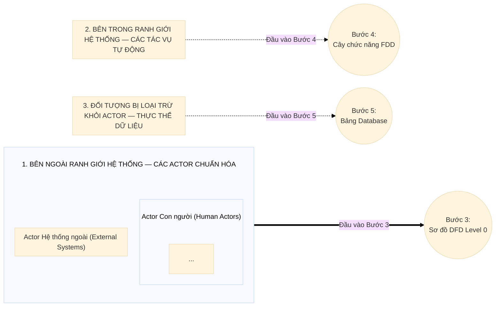

## BƯỚC 2: TRUY VẾT & BÓC TÁCH TÁC NHÂN (7 CÂU HỎI TRUY VẾT ACTOR)
> **File đầu ra:** `md/analysis/2-actor-identification.md`

### 1. Định nghĩa Chuẩn về Actor (Tác nhân)
- **Actor** là bất kỳ thực thể nào **nằm ngoài ranh giới hệ thống (System Boundary)** có tương tác trực tiếp (gửi dữ liệu Input hoặc nhận kết quả Output) với hệ thống qua UI hoặc API.
- Actor đại diện cho **Vai trò (Role)** gắn với quyền hạn trong hệ thống, không phải chức danh hành chính ngoài đời hay một cá nhân cụ thể.

### 2. Bảy Câu hỏi Truy vết Actor (Từ kết quả 5 Câu hỏi Khảo sát ở Bước 1)
Sử dụng trực tiếp câu trả lời của Bước 1 để quét qua 7 câu hỏi truy vết nhằm không bỏ sót bất kỳ Actor hay tiến trình nào:

| Thứ tự | Câu hỏi truy vết | Tìm đối tượng nào? | Lấy nguồn dữ liệu từ đâu ở Bước 1? |
|:---:|---|---|---|
| **Câu 1** | **Ai trực tiếp đưa dữ liệu mới vào hệ thống?** | Primary Actor (Người nhập liệu, khởi phát quy trình) | Câu 2 (Quy trình hiện tại) & Câu 4 (Ai sử dụng) |
| **Câu 2** | **Ai tiếp nhận, duyệt hoặc xử lý bước tiếp theo?** | Secondary Actor (Người xử lý quy trình kế tiếp) | Câu 3 (Vấn đề quy trình) & Câu 4 (Ai sử dụng) |
| **Câu 3** | **Ai xem báo cáo, giám sát và ra quyết định?** | Supervisory Actor (Người quản lý, giám sát, đối soát) | Câu 4 (Ai sử dụng) & Câu 5 (Kết quả mong muốn) |
| **Câu 4** | **Khách hàng/Người dùng cuối tương tác trực tiếp hay gián tiếp?** | Self-service User (Tự thao tác hay nhân viên nội bộ nhập hộ?) | Câu 2 (Kênh tiếp nhận) & Câu 4 (Ai sử dụng) |
| **Câu 5** | **Hệ thống có trao đổi dữ liệu tự động với bên thứ 3 nào không?** | External System (AI API, TTS, YouTube API, Thanh toán, Vận chuyển...) | Câu 1 (Ranh giới hệ thống) & Câu 5 (Kết quả mong muốn) |
| **Câu 6** | **Có nghiệp vụ nào tự động chạy ngầm theo thời gian/hàng đợi không?** | Automated Process / Background Job (Cron job, Queue worker) | Câu 3 (Khâu thủ công cần tự động hóa) & Câu 5 |
| **Câu 7** | **Ai quản trị tài khoản, phân quyền và cấu hình nền tảng?** | System Admin (Quản trị viên hệ thống) | Câu 4 (Ai sử dụng) & Yêu cầu vận hành hệ thống |

### 3. Bốn Quy tắc Chuẩn hóa & Loại trừ Sai lầm
1. **Gộp chức danh trùng quyền:** Nhiều chức danh ngoài đời có cùng quyền hạn trên phần mềm phải gộp thành 1 Actor duy nhất.
2. **Phân biệt Actor vs Data Entity:** Đối tượng không tự thao tác trực tiếp trên hệ thống mà do người khác nhập thông tin vào lưu trữ chỉ là **Thực thể dữ liệu (`Entity`)**, không phải Actor.
3. **Loại bỏ Hệ thống ngoài giả định:** Nếu việc giao dịch thực hiện thủ công bên ngoài rồi con người tự nhập kết quả vào phần mềm thì không có Actor Hệ thống ngoài.
4. **Tác vụ tự động (Cron Job / Queue) KHÔNG phải là Actor:** Tiến trình tự chạy nằm **bên trong** ranh giới hệ thống nên không vẽ thành Actor trên DFD Level 0, nhưng phải lập bảng riêng ở cuối Bước 2 để bắt buộc đưa vào Sơ đồ phân rã chức năng (FDD) ở Bước 4.

### 4. Quy tắc Vẽ Sơ đồ Phân loại Actor & Ranh giới Hệ thống (Mermaid `flowchart LR`)
Cuối tài liệu Bước 2 bắt buộc vẽ **Sơ đồ Phân loại Actor & Ranh giới Hệ thống** gồm 3 khối (`subgraph`) nối tới đích truy vết của các bước tiếp theo.
- **Quy tắc định dạng chống tràn & đè chữ:** Sử dụng block `init` để cấu hình `fontSize: '14px'`, `subGraphTitleMargin: { 'top': 25, 'bottom': 45 }`, và `direction LR` cho hàng Actor con người:

1. **`1. BÊN NGOÀI RANH GIỚI HỆ THỐNG — CÁC ACTOR CHUẨN HÓA`:** Chia thành 2 nhóm con `Actor Con người (Human Actors)` (ghi rõ mã `ACT-xx`, tên Actor, phân loại) và `Actor Hệ thống ngoài (External Systems)` ➔ Nối mũi tên **`Đầu vào Bước 3 (Sơ đồ DFD Level 0)`**.
2. **`2. BÊN TRONG RANH GIỚI HỆ THỐNG — CÁC TÁC VỤ TỰ ĐỘNG CHẠY NGẦM`:** Liệt kê các `Cron Job / Background Queue` (từ Câu 6) ➔ Nối mũi tên nét đứt **`Đầu vào Bước 4 (Cây chức năng FDD)`**.
3. **`3. ĐỐI TƯỢNG BỊ LOẠI TRỪ KHỎI ACTOR — CHUYỂN THÀNH THỰC THỂ DỮ LIỆU`:** Liệt kê các đối tượng thụ động không trực tiếp đăng nhập (từ Câu 4) ➔ Nối mũi tên nét đứt **`Đầu vào Bước 5 (Bảng Database)`**.

