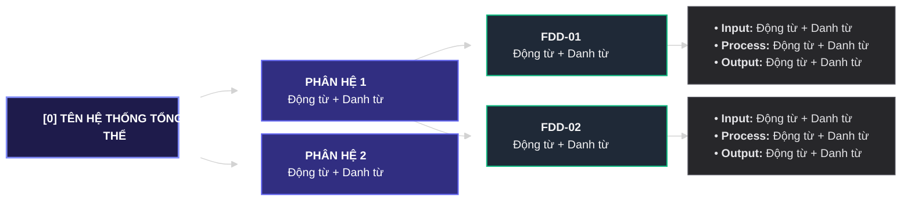

## BƯỚC 4: SƠ ĐỒ PHÂN RÃ CHỨC NĂNG (FDD 3 CẤP) & MA TRẬN RBAC
> **File đầu ra:** `md/analysis/4-fdd-and-rbac.md`

### 1. Nguyên tắc MECE & Cú pháp Đặt tên
- **Chuyển góc nhìn từ "Ai làm (Who)" sang "Hệ thống có gì (What)":** Tuyệt đối không lấy danh sách Actor ở Bước 2 làm các nhánh Cấp 1 của FDD. Phải mở hộp đen hệ thống và chia nhánh theo **Miền nghiệp vụ / Đối tượng dữ liệu cốt lõi (Core Entity)**.
- **Nguyên tắc MECE (Không trùng lặp - Không bỏ sót):** Mỗi chức năng chỉ xuất hiện **duy nhất 1 lần** trên toàn sơ đồ FDD. Nếu nhiều Actor cùng thực hiện 1 hành động ở Bước 3, phải hợp nhất thành **1 chức năng duy nhất** trên FDD và phân định quyền ở bảng RBAC.
- **Cú pháp bắt buộc:** 100% các nút ở mọi cấp (Cấp 1, Cấp 2, Cấp 3) phải bắt đầu bằng **`Động từ + Danh từ`**.

### 2. Công thức Phân rã Cây Chức năng 3 Cấp
- **Cấp 0 (Root):** Tên hệ thống tổng thể.
- **Cấp 1 (Phân hệ / Module):** Gom các mục tiêu hệ thống (từ Bước 1) thành 4–6 khối nghiệp vụ độc lập tương đối.
- **Cấp 2 (Chức năng nghiệp vụ — Đơn nhiệm):** Mỗi ô Cấp 2 chỉ quản lý đúng 1 đối tượng hoặc 1 nghiệp vụ độc lập. Kiểm soát số lượng bằng công thức bảo toàn:
  > **Tổng Chức năng Cấp 2 = Tổng Hành động Actor (Bước 3) − Số Hành động trùng giữa các Actor + Số Tác vụ tự động (Bước 2)**
- **Cấp 3 (Tác vụ chi tiết — Nhịp IPO):** Bóc tách trực tiếp từ cột `Dữ liệu Input` và `Dữ liệu Output` ở Bước 3 theo 3 nhịp:
  1. **Input:** Tiếp nhận / chọn dữ liệu đầu vào hoặc tiêu chí lọc.
  2. **Process:** Kiểm tra điều kiện, ràng buộc nghiệp vụ, xử lý/tính toán lõi.
  3. **Output:** Lưu trạng thái, phát sinh dữ liệu/hàng đợi và trả kết quả.

### 3. Ma trận Truy vết RBAC & Phân tách Trách nhiệm (SoD)
- Cuối tài liệu FDD bắt buộc lập bảng: `| STT | Mã FDD | Tên chức năng Cấp 2 | Nguồn Hành động / Tác vụ (Bước 2 & 3) | Bảng DB dự kiến | Quyền theo từng Role |`.
- Áp dụng nguyên tắc **Phân tách trách nhiệm (Separation of Duties - SoD)**: Tách bạch quyền **Quản trị cấu hình/dữ liệu nguồn** và quyền **Vận hành tác nghiệp**.

### 4. Quy tắc Vẽ Sơ đồ Cây Phân rã Chức năng FDD 4 Tầng (`Cấp 0 ➔ Cấp 1 ➔ Cấp 2 ➔ Cấp 3` — Mermaid `flowchart LR`)
Tài liệu Bước 4 bắt buộc có **Sơ đồ cây FDD** phân rã theo chiều ngang từ Trái sang Phải (`flowchart LR`) hiển thị đầy đủ cả 4 tầng (**Cấp 0 ➔ Cấp 1 ➔ Cấp 2 ➔ Cấp 3**):
1. **Nguyên tắc Khống chế Chiều ngang 4 Cột (Chống thu nhỏ chữ):**
   - **Cột 1 — Cấp 0 (Root):** 1 nút gốc duy nhất đại diện cho toàn bộ hệ thống (`[0] Tên Hệ Thống`).
   - **Cột 2 — Cấp 1 (Phân hệ / Module):** Các khối phân hệ nghiệp vụ lớn (`Động từ + Danh từ`).
   - **Cột 3 — Cấp 2 (Chức năng nghiệp vụ đơn nhiệm):** Các ô chức năng gắn mã `FDD-01`, `FDD-02`... (`Động từ + Danh từ`) tự động xếp dọc từ trên xuống.
   - **Cột 4 — Cấp 3 (Tác vụ chi tiết — Nhịp IPO):** Mỗi chức năng Cấp 2 nối sang 1 khối Cấp 3 tổng hợp đủ 3 nhịp (`• Input: ...`, `• Process: ...`, `• Output: ...`), đồng thời đặc tả chi tiết trong bảng IPO ở Mục 3.
2. **Cấu hình Template chuẩn cho Sơ đồ FDD (`flowchart LR`):**

